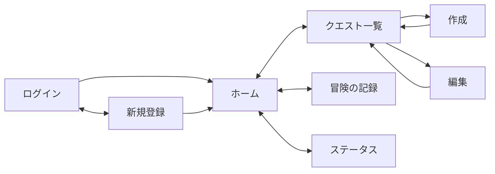
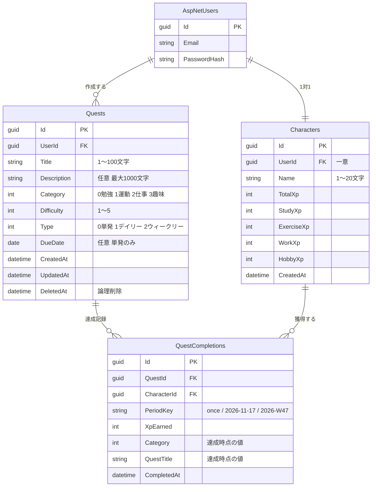

# RealGuild 基本設計書

- **状態: 承認済み（2026-11-17）** ※ 変更する場合はユーザーの合意を得て、決定事項に記録する
- 作成: Claude Code / 最終更新: 2026-11-17
- 前提: [requirements.md](requirements.md)（承認済み）、[tech-stack.md](tech-stack.md)

---

## 1. 全体方針

- **ゲームのルールはすべてバックエンドで計算する。** フロントは結果を表示し、演出するだけにする。
- **日付の区切りは日本時間（Asia/Tokyo）にする。** DB には UTC（世界標準時）で保存し、「今日」「今週」の判定はバックエンドで日本時間に変換してから行う。
- **週は月曜始まりにする。**
- 最初はシンプルな構成で作り、機能が増えたら分割する。

---

## 2. 画面設計

### 2.1 画面一覧

| ID | 画面 | URL | ログイン | 機能 |
|---|---|---|---|---|
| S1 | ログイン | `/login` | 不要 | F1 |
| S2 | 新規登録（キャラクター作成） | `/register` | 不要 | F1, F2 |
| S3 | ホーム | `/` | 必要 | F5, F4 |
| S4 | クエスト一覧 | `/quests` | 必要 | F3, F4 |
| S5 | クエスト作成 | `/quests/new` | 必要 | F3 |
| S6 | クエスト編集 | `/quests/:id/edit` | 必要 | F3 |
| S7 | 冒険の記録 | `/log` | 必要 | F6 |
| S8 | ステータス | `/character` | 必要 | F2 |

- レベルアップの演出は、画面ではなく**全画面に重ねて表示するモーダル**として作る（どの画面で達成しても表示されるようにするため）。
- ログアウトはメニューから行う。

### 2.2 画面遷移



### 2.3 レイアウト（スマホと PC の両対応）

```
【スマホ】                     【PC】
┌──────────────┐              ┌────────┬──────────────────────┐
│ ヘッダー（Lv/EXP）│              │ サイド  │ メインコンテンツ          │
├──────────────┤              │ ナビ    │                       │
│              │              │ ・ホーム │  （ホーム画面ではキャラ   │
│ メイン         │              │ ・クエスト│   ステータスとクエスト    │
│              │              │ ・記録   │   一覧を横に並べる）      │
├──────────────┤              │ ・ステータス│                       │
│ 下部タブナビ      │              │        │                       │
└──────────────┘              └────────┴──────────────────────┘
```

- 画面幅が 768px 未満なら下部のタブナビ、768px 以上ならサイドナビに切り替える。
- クエストを作成するボタンは、スマホでは画面右下の丸いボタン（FAB）、PC では一覧の上部に置く。

### 2.4 デザインの方向性

- **テーマ: レトロな携帯ゲーム機の RPG 風ドット絵**（2026-11-17 ユーザー要望により変更）。特定のゲームを再現するのではなく、ジャンルの雰囲気をオリジナルで表現する。
- フォント: DotGothic16（日本語対応のドット絵フォント）。ドット絵がにじまないよう、擬似的な太字は使わない。
- ウィンドウ: 二重線の枠で、角を 1 ドット欠けさせた四角いウィンドウ（`.pixel-window`）。
- 選択中の項目には ▶ カーソル、メッセージウィンドウには点滅する ▼ を表示する。
- 経験値はブロック状のゲージで表示し、1 マスずつ溜まる演出にする。
- キャラクターはオリジナルの 16×16 ドット絵（SVG）。色は配色パレットに追従させる。
- 文言は、ひらがなを多めにしたゲーム風の言い回しにする（例: 「きょうの クエスト」）。
- **配色は 3 種類をユーザーが選べる**（F7。`<html data-palette>` で切り替え）: 勇者の夜（黒いウィンドウ×白枠、既定）/ 草原（明るい携帯機風）/ クラシック（4 階調グリーン）。色は CSS 変数で定義し、新しい色を追加するときは 3 つすべてに定義する。

---

## 3. ゲームのルール（計算式）

### 3.1 獲得経験値

| 難易度 | ★1 | ★2 | ★3 | ★4 | ★5 |
|---|---|---|---|---|---|
| 経験値 | 10 | 20 | 40 | 80 | 150 |

### 3.2 レベル

- レベル L から L+1 に上がるのに必要な経験値は **100 + (L − 1) × 50**。
  - 例: Lv1→2 は 100、Lv2→3 は 150、Lv9→10 は 500
  - Lv10 になるまでの累計は 2,700。1 日に ★3 を 3 個（120 経験値）こなすと、約 3 週間で到達する
- 最大レベルは 99。
- レベルは**累計経験値から計算で求める**（DB には累計経験値だけを保存する）。

### 3.3 能力値

- カテゴリごとに経験値を集計し、**能力値 = 1 + floor(カテゴリ経験値 ÷ 100)** とする。
  - 例: 勉強の経験値が 350 なら、知力は 4
- 能力値も累計値から計算で求める。

### 3.4 達成と取り消しのルール

| 種類 | 達成できる回数 | 再び達成できるようになるタイミング |
|---|---|---|
| 単発 | 1 回だけ | なし（達成済みになる） |
| デイリー | 1 日 1 回 | 日本時間の 0 時 |
| ウィークリー | 1 週 1 回 | 日本時間の月曜 0 時 |

- 二重の達成は、**DB の一意制約**（同じクエストと期間の組み合わせは 1 件しか登録できない制約）で防ぐ。
- 取り消しは、**達成した日（日本時間）のうちだけ**できる。取り消すと経験値も戻り、レベルが下がることもある。

---

## 4. データベース設計

### 4.1 ER 図



### 4.2 設計のポイント

- **ユーザー管理は ASP.NET Core Identity の標準テーブル（AspNetUsers など）を使う。** キャラクターは別テーブルにして、ユーザーと 1 対 1 で結びつける。
- **キャラクターには経験値の合計をカテゴリ別に保存する。** 達成のたびに履歴から集計し直さなくてよいので、ホーム画面の表示が速くなる。達成記録の追加と経験値の加算は**同じトランザクション**（両方成功するか、両方取り消されるかのどちらかになる処理のまとまり）で行う。
- **クエストは論理削除にする。** `DeletedAt` に削除日時を入れて非表示にするだけなので、過去の達成記録は残る。
- **達成記録には、達成時点のタイトル・カテゴリ・獲得経験値を保存する。** あとでクエストを編集しても、過去の記録は変わらない。
- **`(QuestId, PeriodKey)` に一意制約を付ける。** 連打や通信の再送が起きても、二重に達成されない。
- 主なインデックス: `Quests(UserId, DeletedAt)`、`QuestCompletions(CharacterId, CompletedAt)`
- enum（カテゴリなどの選択肢）は、C# の enum を DB に整数で保存する。

---

## 5. API 設計

### 5.1 共通ルール

- ベースのパスは `/api`。JSON でやり取りする。項目名は camelCase（例: `totalXp`）。
- 認証は Cookie（ASP.NET Core Identity）。ログインが必要な API で未ログインなら **401** を返す（ログイン画面へのリダイレクトはしない）。
- エラーは **ProblemDetails 形式**（ASP.NET Core 標準のエラー形式）で返す。入力チェックのエラーは 400 で、項目ごとのメッセージを付ける。
- 他のユーザーのクエストを操作しようとした場合は 404 を返す（データの存在自体を知られないようにするため）。
- **CSRF 対策**（ログイン中のユーザーに、別サイトから勝手に API を実行させる攻撃への対策）: 認証 Cookie を `SameSite=Strict`・`HttpOnly`・`Secure` にする。さらに、状態を変更する API は JSON のリクエストだけを受け付ける。

### 5.2 エンドポイント一覧

| メソッド | パス | 内容 | 機能 |
|---|---|---|---|
| POST | `/api/auth/register` | 新規登録とキャラクター作成を行い、ログイン状態にする | F1, F2 |
| POST | `/api/auth/login` | ログイン | F1 |
| POST | `/api/auth/logout` | ログアウト | F1 |
| GET | `/api/auth/me` | ログイン中のユーザー情報（ログイン状態の確認用） | F1 |
| GET | `/api/character` | キャラクター情報（レベル、経験値、能力値など） | F2, F5 |
| PATCH | `/api/character` | キャラクター名の変更 | F2 |
| GET | `/api/quests` | クエスト一覧（`?category=&status=` で絞り込み） | F3 |
| GET | `/api/quests/today` | 今日やるべきクエスト | F5 |
| GET | `/api/quests/{id}` | クエストの詳細 | F3 |
| POST | `/api/quests` | クエストの作成 | F3 |
| PUT | `/api/quests/{id}` | クエストの更新 | F3 |
| DELETE | `/api/quests/{id}` | クエストの削除（論理削除） | F3 |
| POST | `/api/quests/{id}/complete` | 達成する | F4 |
| DELETE | `/api/quests/{id}/complete` | 今日の達成を取り消す | F4 |
| GET | `/api/completions` | 達成履歴（`?page=&pageSize=`） | F6 |
| GET | `/api/stats/summary` | 集計（`?period=week` または `month`） | F6 |

### 5.3 主要 API の例

**POST `/api/quests/{id}/complete`** のレスポンス（200）

```json
{
  "xpEarned": 40,
  "leveledUp": true,
  "previousLevel": 4,
  "character": {
    "name": "ヒロ",
    "level": 5,
    "totalXp": 720,
    "xpIntoLevel": 20,
    "xpForNextLevel": 300,
    "stats": { "int": 4, "str": 3, "dex": 2, "cha": 1 }
  }
}
```

- 既に達成済みの場合は **409 Conflict** を返す。
- フロントは `leveledUp` が true のとき、レベルアップの演出を表示する。

**ログイン API について**: Identity には登録・ログインの API をまとめて作る機能（`MapIdentityApi`）がある。しかし、登録と同時にキャラクターを作れないことと、C# を学ぶ目的があることから、**AuthController を自前で作る**（中では Identity の `UserManager` / `SignInManager` を使う）。

---

## 6. バックエンドの構成

1 つのプロジェクトの中を、フォルダで役割ごとに分ける。

```
src/RealGuild.Api/
  Controllers/      API の入り口。入力を受け取って Service を呼ぶだけにする
  Services/         処理の流れ（クエスト達成など）。DB を操作する
  Domain/
    Entities/       Character, Quest, QuestCompletion
    GameRules/      経験値・レベル・能力値・期間（PeriodKey）の計算。DB に依存しない純粋なロジック
  Contracts/        リクエストとレスポンスの型（record）
  Data/             AppDbContext、テーブルの詳細設定、マイグレーション
```

- **GameRules は単体テストを重点的に書く**（レベル計算や日付の区切りなどは間違えやすいため）。
- 時刻は `TimeProvider`（.NET 標準の時刻取得の仕組み）から取得する。テストで「今」を自由に変えられるので、日付の区切りをテストしやすくなる。

## 7. フロントエンドの構成

```
src/
  pages/          画面（S1〜S8）
  components/
    ui/           shadcn/ui の部品
    game/         経験値バー、依頼書カード、レベルアップのモーダルなど
    layout/       ヘッダー、ナビ
  features/       機能ごとの API 呼び出しと型（auth, quests, character, log）
  lib/            共通処理（api.ts など）
```

- **React Router**: URL と画面を対応させる（ルーティング）
- **TanStack Query**: API から取得したデータのキャッシュ、再取得、読み込み中の状態をまとめて管理する

---

## 8. 決定事項

| 日付 | 内容 |
|---|---|
| 2026-11-17 | 基本設計を承認 |
| 2026-11-17 | フロントの周辺ライブラリに React Router と TanStack Query を採用 |
| 2026-11-17 | デザインをドット絵 RPG 風に変更。配色 3 種類の切り替えを正式機能（F7）にする |
